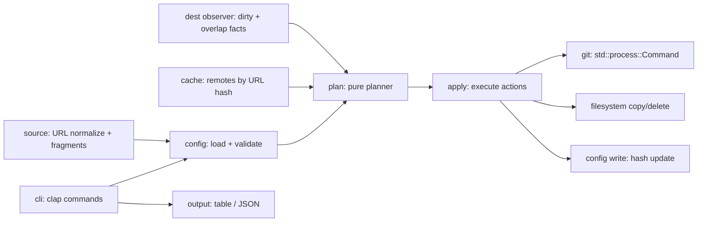

# High-Level Design: athena (Skill & Plugin Manager)

`athena` is the binary name. It also names the config files (`athena.toml`) and the cache and config directories (`~/.cache/athena/`, `~/.config/athena/`).

## Problem

AI "skills" and "plugins" are distributed as folders inside Git repositories. Users copy them by hand into agent directories, with no record of where they came from, which commit they are at, or whether local edits exist. Updating means re-copying and risks overwriting local work. Cloning repositories straight into agent directories produces nested `.git` directories and repeated network fetches.

## Approach

`athena` is a Rust CLI that treats skills and plugins as declared dependencies locked to exact commits:

- **Declared state** lives in a TOML file: `./athena.toml` (local scope) or `~/.config/athena/config.toml` (global scope). Each entry names a Git source, a locked commit, an optional subpath, and an optional install path.
- **Shared cache.** Every remote is shallow-fetched once into `~/.cache/athena/remotes/`, keyed by a hash of the normalized source URL. Installs are file copies out of this cache, never clones into destinations.
- **Plan/apply.** Every mutating command (`add`, `remove`, `update`, `sync`) first computes a pure `Plan` — an ordered list of actions (fetch, copy, delete, gobble) — from the declared state, the cache state, and the destination state. A separate `apply` step executes it. All safety rules (dirty destinations, path collisions, parent/child overlap) are evaluated while building the plan, as pure functions over already-observed inputs.
- **Install record.** Each entry carries a `hash` field: a content hash of the files `athena` last wrote to its destination. Dirty detection for non-git destinations compares the destination against that hash. Git destinations additionally use `git status`. The tool rewrites the TOML with `toml_edit`, so user comments and formatting survive.
- **Source patterns.** A source's subpath may contain glob patterns (`*`, `?`, `{a,b}`), as in `github.com:org/repo#main:/skills/*`. `add` expands the pattern against the folders that exist at the resolved commit and creates one ordinary entry per match. The config never stores a pattern, so every installed skill is pinned, updated, and removed on its own.
- **Skill layout check.** `add` refuses a skill whose folder has no `SKILL.md` at its root, and says how to proceed: a glob subpath when the source is a collection of skills, or `--no-skill-check` to install it anyway.
- **Native git.** All Git access goes through the `git` executable via `std::process::Command`. No `git2`.

## Target Users

- Developers who keep agent skills and plugins in project directories and want them reproducible across machines and teammates.
- AI agents that drive `athena` and read its `--json` output.

## Goals

- `athena sync` on a clean checkout reproduces every declared package at its locked commit.
- No command overwrites or deletes user-modified files in a destination without `--force`.
- Two entries demanding different commits at one destination path are rejected on config load.
- Every destination path has exactly one owner: a local entry overlapping a global path blocks local `add`, `sync`, and `update` until the user removes one side.
- A mistyped source, subpath, or pattern fails on `add` with nothing installed, instead of installing the wrong files.
- Repeated `sync` with an unchanged config performs no network access once the cache holds the commits.

## Non-Goals

- No package registry or search; sources are Git URLs or local paths.
- No dependency resolution between packages.
- No semantic versioning; entries lock to commits (branches and tags are resolved to commits).
- No behavioral difference between skills and plugins beyond the default install path and the `SKILL.md` check on `add`.
- No collection entries: a pattern is expanded once, on `add`. Skills that a repository gains later are not picked up by `update`; re-running the same `add` installs the new ones and skips those already added.
- No Windows-specific path handling in v1.

## Tenets

- **Refuse over proceed.** When a destination is dirty, a path overlap is ambiguous, or state cannot be verified, stop and report. Only `--force` overrides.
- **Config is truth.** `sync` makes disk match the TOML. It never adopts on-disk state into the config. The `hash` field is derived bookkeeping, written only by `athena` after an install.

## System Design

Components and boundaries:

- **cli** — argument parsing and dispatch; owns no logic.
- **source** — turns user input (shorthand, SSH, HTTPS, `#ref:/subpath` fragments) into a normalized URL, ref, and subpath.
- **config** — reads and writes both TOMLs, applies `[core]` default paths, validates path collisions on load, and detects local entries that conflict with global ones.
- **cache** — maps a normalized URL to a cache directory; fetches and resolves refs to commit SHAs through `git`.
- **dest observer** — gathers facts about destinations (exists, is a git repo, dirty, differs from recorded hash). Impure by design; its output is plain data.
- **plan** — pure function from (config, cache facts, destination facts, flags) to a `Plan` or a refusal. Contains the collision, gobble, and dirty rules.
- **apply** — executes a `Plan`; the only component that mutates disk besides cache fetches.
- **output** — tables (`comfy-table`) and strict JSON.

## Key Design Decisions

| Decision | Choice | Alternatives | Rationale |
|---|---|---|---|
| Overall structure | Single crate, plan/apply pipeline | Layered modules without a plan step; workspace of lib + bin | The main risk is data loss. A pure plan makes dirty, collision, and gobble rules testable without touching disk, and makes dry-run cheap. A workspace adds files with no second consumer. |
| Dirty detection for non-git destinations | Content hash stored in the entry's `hash` field at install | Separate `athena.lock` state file; compare against cache copy; skip detection | One file instead of two, and a hand-edited pin still syncs because the destination matches the stored hash. A cache comparison reports a clean destination as dirty after `update` or a hand edit; skipping violates the no-data-loss goal. A lock file keeps hashes out of the config but adds a second file to keep coherent. |
| `commit = "HEAD"` or a branch | Resolved to a SHA when written to config | Store the symbolic ref and re-resolve on `sync` | Reproducibility: `sync` must produce the same files on every machine. `update` is the only command that moves a locked commit. |
| Fetching a locked commit | `git fetch --depth 1 origin <sha>`, full fetch as fallback | `--depth 1` clone only | A shallow clone of the default branch cannot reach an older locked SHA. |
| `type = "local"` | Files are copied; `update` is a no-op | Symlink | Symlinks make "dirty" and removal ambiguous and leak the source directory into the project. |
| Skills vs plugins | Same machinery; differ in default path and the `SKILL.md` check | Separate install pipelines | Both are directories of files copied from a source. Skills share one well-known marker file, so only skills are checked; plugin layouts differ too much between agents for a marker check to be reliable. |
| Glob subpaths | Expanded on `add` into one concrete entry per match | Store the pattern as a collection entry that re-expands on `update` | Concrete entries reuse every existing rule (locking, pinning, dirty checks, removal) unchanged and keep the config readable. A collection entry would need its own lifecycle for members that appear or disappear upstream. |
| Skill without `SKILL.md` | `add` aborts, suggesting a glob subpath or `--no-skill-check` | Warn and install; no check | A missing marker almost always means the wrong repository, subpath, or a collection installed as one skill; installing it anyway puts files where no agent will load them. The flag keeps other agents' layouts installable. |
| Project tooling | `mise`: `mise.toml` pins the Rust toolchain and defines the `build`, `test`, `lint`, and `fmt` tasks | `rust-toolchain.toml` plus cargo aliases; `just` or `make` | One tool pins the toolchain and runs tasks, so contributors and agents use a single entry point (`mise run <task>`). |

## Success Metrics

- Every safety rule (dirty destination, collision, gobble) has a planner test that needs no filesystem.
- A `sync` on an unchanged config after a first run performs zero `git` network calls.
- Falsification: any command that deletes or overwrites a modified destination file without `--force` means the design failed.

## References

- `docs/intent/` — component designs and their EARS specs.
